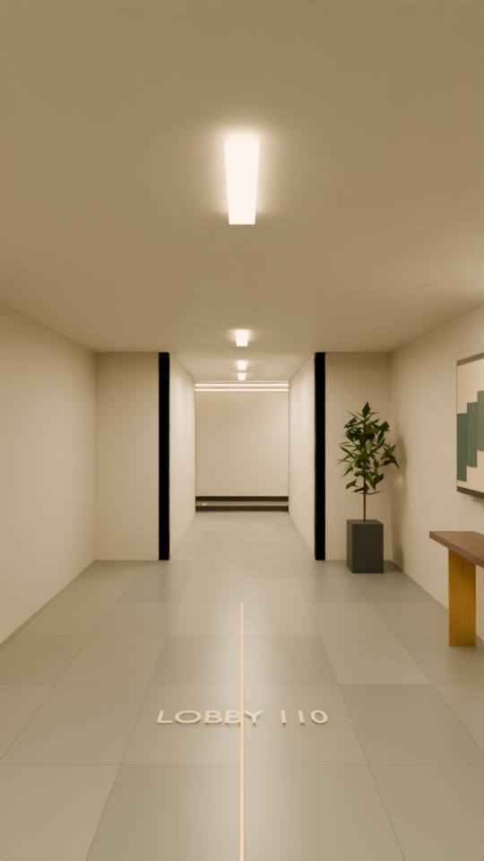
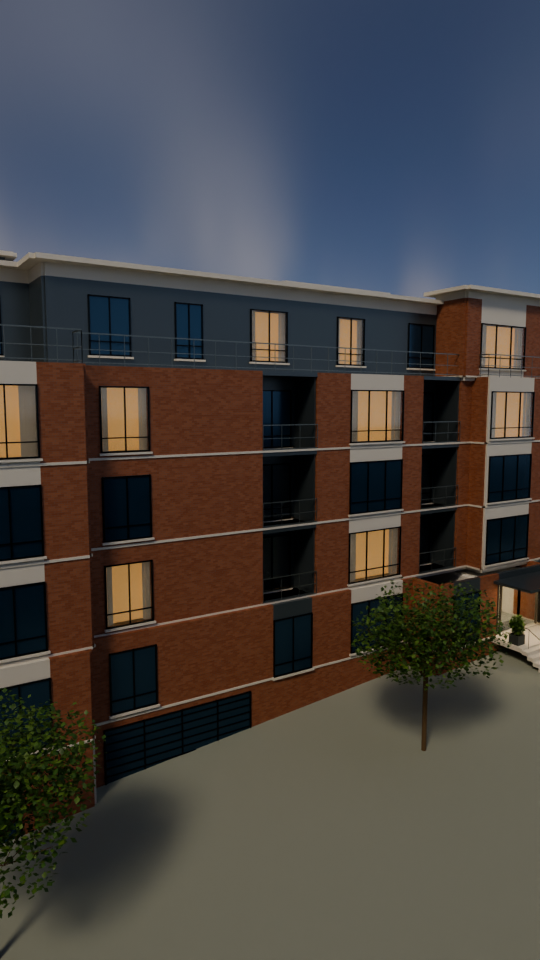
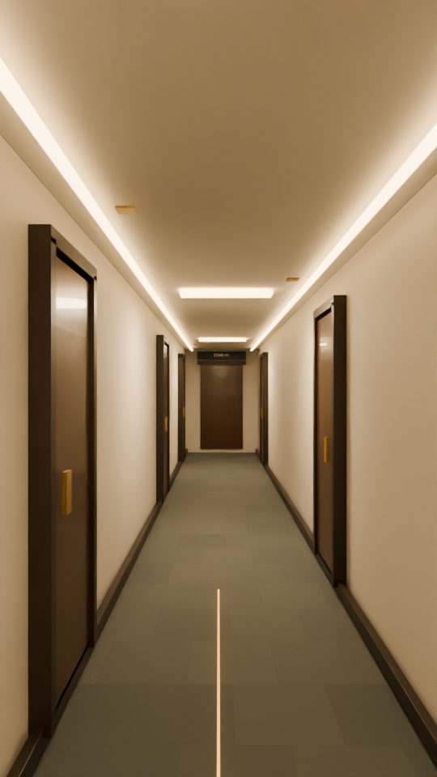

# Highland / archviz review

Native Blender **Cycles** previews, formatted for a phone. This is the next visual pass on the existing walkthrough: more realistic finishes and lighting, with the same drawing-based circulation, opening doors, moving elevator and X-ray section.

## Lobby

[Compare the previous study and upgraded lobby](Compare-lobby.jpg)

## Exterior

[Compare exterior lighting and planting](Compare-exterior.jpg)

## Elevator

[Compare elevator finishes](Compare-elevator.jpg)

## Upper corridor

[Compare carpet, door finishes and wall lighting](Compare-corridor.jpg)

## Editable scene and render status

[Download the Blender scene](Highland-archviz.blend?raw=true) — Blender **5.0.1 or newer**. Play frames 1–624 at 24 fps. The HDRI and ambient soundtrack are packed; no paid add-ons or botanical libraries are needed.

These four stills are 540 × 960, 24 samples, denoised. Each comparison uses the previous published scene at the same frame, resolution and sample count. The upgraded **full animation has not been rendered**. The [earlier film](../highland-blender/README.md) retains the previous study appearance.

The upgrade adds 36,100 individual procedural exterior leaves, 60 warm window recesses with folded curtains, entrance handrails and planters, a console and original abstract art in the lobby, finer vertically oriented wood grain, brushed metal, tile grout, carpet weave, and soft door accent beams. The sky is a packed [CC0 Poly Haven HDRI](../../projects/highland-drone/assets/README.md). Planting, furniture, apartment back panels, finishes and fixture optics are illustrative; no surveyed unit interiors or manufacturer IES profiles are represented.

[Camera validation](Highland-archviz.validation.json) checks all 624 film frames against modeled walls, furniture boxes and moving door leaves. It reports no intersections during the walkthrough and preserves the 123-inch R1-to-R2 elevator rise. The intentional section pullback is excluded from wall checks. This validates the modeled route, not undimensioned existing conditions.

[Rebuild and render instructions](../../projects/highland-drone/BLENDER.md) · [Image provenance](review-manifest.json)
