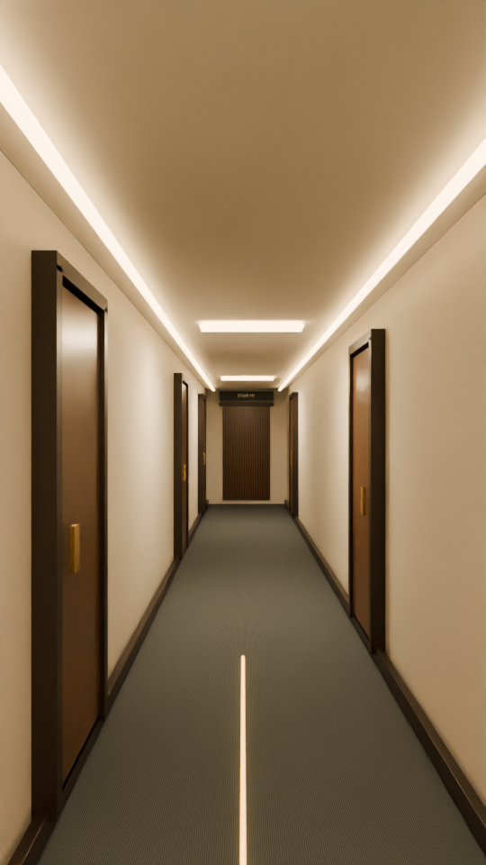

# Highland native Blender walkthrough

- [Editable animated Blender scene](Highland-walkthrough.blend)
- [Watch the native Blender film](Highland-Blender-walkthrough.mp4)
- [Corridor poster](Highland-Blender-poster.png)
- [Elevator section view](Highland-Blender-section.png)
- [Short animation preview](Highland-Blender-preview.gif)
- [Larger lobby review render](Highland-Blender-lobby-review.png)
- [Larger section review render](Highland-Blender-section-review.png)
- [Scene and camera checks](Highland-walkthrough.validation.json)
- [Film checks](media-validation.json)
- [Rebuild, render and source notes](../../projects/highland-drone/BLENDER.md)

Open the scene in Blender 5.0.1 or newer and play frames 1–624. The camera,
entry hinges, elevator doors, moving cab, animated Boolean section, materials,
lights and wayfinding are editable native Blender objects and keyframes. The
ambient score is packed into the file.

The film is rendered with Cycles CPU in GitHub Actions. Lobby and corridor
locations follow the drawing study; exact wall faces, doors, elevator details
and finishes remain illustrative. See the source notes before presenting this
as a view of existing conditions.
