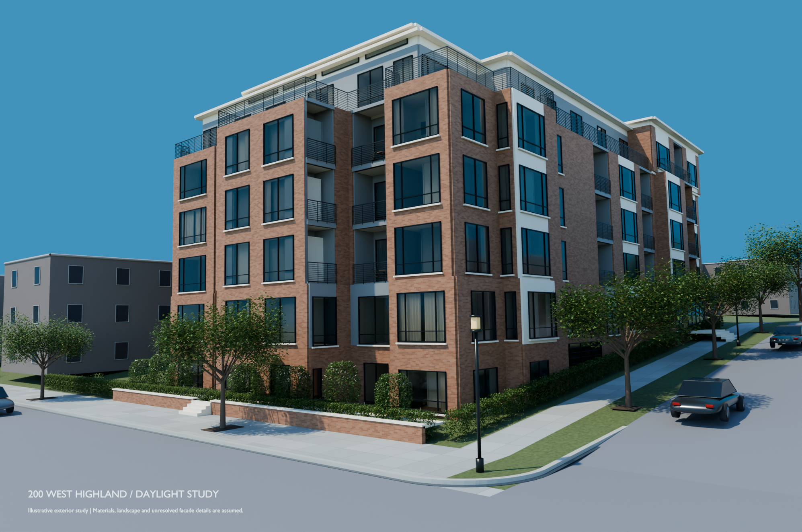

# Highland / daylight revision 02

[Daylight still](Highland-daylight-photo-study.png) · [Photo and drawing comparison](Highland-daylight-source-comparison.pdf) · [Editable Blender scene](Highland-daylight-photo-study.blend?raw=true) · [Portable GLB](Highland-daylight-photo-study.glb?raw=true)

This continues the exterior handoff with one closer photo-reference view, warmer brick, clearer window reflections, varied curtains, a clear sky and layered terrace planting. The still is **1995 × 1323**, rendered in native Blender Cycles with up to 64 samples and denoising. Open the packed `.blend` in Blender 5.0.1 at **Daylight photo study / revision 02**. It needs no external textures or add-ons.

The camera fit reduces the root-mean-square mismatch at nine manually selected photo correspondences from **49.67 px to 9.78 px** on the supplied 665 × 441 photograph. These are fitting residuals, not independent accuracy measurements. The photo has no calibrated scale, known lens, distortion model or established dimensional tolerance. The roof silhouette and window details still differ from the photograph.

All **955 protected architectural meshes** retain the handoff's vertices, transforms and faces. The model has **175 openings**. All **16 unresolved candidates** were reviewed against the outward-facing registered returns and retained as unresolved. Full original sheets or clearer return photographs are needed to settle them. No construction quantities are issued.

Brick dimensions, finishes, glazing, terrace sections, plant species/dimensions, street details and neighboring appearance remain illustrative. Drawing registration, floor/grid controls and roof datums remain governed by the inherited source specification. The original architectural PDF is absent. The new file contains one daylight scene; the previous [two-scene model and 18-second movie](../highland-refined/README.md) remain available for comparison.

- [Four-page source comparison](Highland-daylight-source-comparison.pdf)
- [Camera fit and individual residuals](camera-fit.json)
- [Opening audit](opening-audit.csv) and [detailed evidence](opening-audit.json)
- [Change ledger](CHANGELOG.md)
- [Native readback and image validation](delivery-validation.json)
- [Saved-scene workflow checks](workflow-input-validation.json)
- [Visual review](visual-review.json)
- [Rebuild instructions and source configuration](../../projects/highland-daylight/README.md)

The GLB carries source/assumption metadata but simplifies procedural materials and excludes the native sky and lighting. Use Blender for the reference appearance.

The local `Highland-daylight-editable.zip`, generated by `projects/highland-daylight/package.py`, bundles the new deliverables, source configuration, scripts, source crops and original packed handoff model. `package-validation.json` records its size, SHA-256 and CRC result; the reproducible archive is omitted from Git to avoid duplicating the individually tracked binaries.

Next work: resolve the north/south return conflicts from stronger source material, assess cornice/window differences against the photograph, then benchmark and revise the dusk movie. No replacement movie is included in this daylight revision.

Source photo: supplied by the owner. Surrounding footprints: [OpenStreetMap contributors](https://www.openstreetmap.org/copyright), ODbL 1.0; heights, registration and facades are approximate. The source handoff includes a packed [Poly Haven sky / CC0](../../projects/highland-cinematic/assets/source.json); this daylight study uses procedural illumination and an interpreted blue background/reflection gradient.
