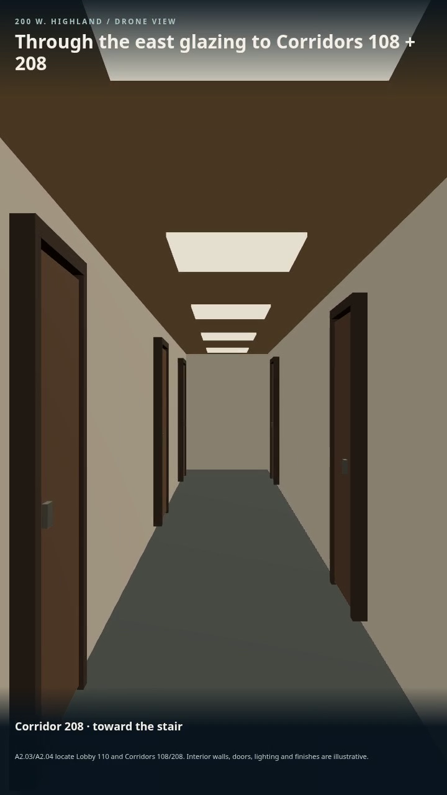
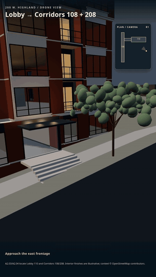

# 200 W. Highland: drone through Corridors 108 and 208

- [Watch the 26-second portrait video](Highland-corridor-drone.mp4)
- [Open the interactive phone tour](Highland-drone-tour.html) (download the HTML and open it in a browser)
- [See source notes and modeling limits](../../projects/highland-drone/README.md)
- [See flight and browser checks](validation.json)

The camera enters the east glazed Lobby 110 frontage, crosses its connector to Corridor 108, takes an illustrative elevator ride to R2, then follows Corridor 208 toward Stair M1. A2.03/A2.04 give these spaces and A3.11 gives the 10 ft 3 in floor rise. Interior wall positions are provisional; doors, lights, elevator details and finishes are illustrative. This is not a verified view of the occupied building.
