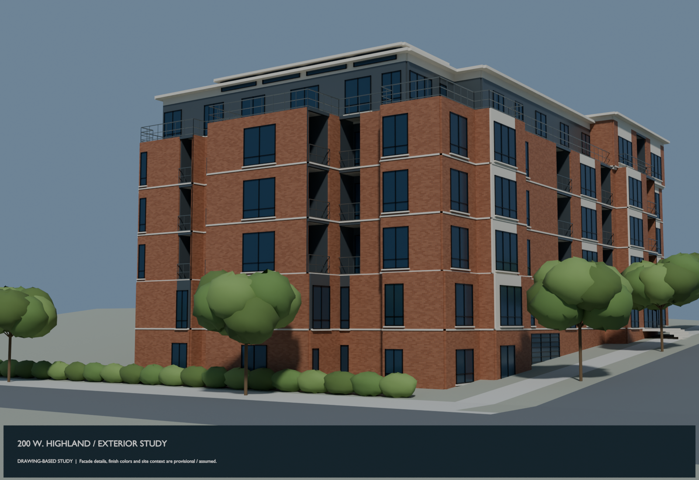

# 200 W. Highland exterior

First exterior study built from the architectural plans and the owner's photos: stepped brick facade, dark windows, recessed balconies, pale roof caps and an uphill street.

- [Southeast view](Highland-exterior-southeast.png)
- [Portrait Cycles preview](Highland-exterior-portrait.png)
- [East entry view](Highland-exterior-east-entry.png)
- [Review PDF: four elevation comparisons, roof and provenance](Highland-exterior-review.pdf)
- [Editable Blender model](Highland-exterior.blend)
- [Portable 3D model (GLB)](Highland-exterior.glb)
- [Sources, assumptions and reproduction instructions](../../projects/highland-exterior/README.md)
- [Visual review and unresolved details](../../projects/highland-exterior/report.md)
- [Checks](validation.json)
- [Element-by-element source and assumption inventory](elements.json)

For binary files, use GitHub's **Download raw file** button. Blender retains the procedural brick material; GLB displays a simplified base color.

This is a drawing-based exterior study with photo-informed finishes, not a verified as-built. Window dimensions, balcony details, materials and site context remain approximate. Twenty-six opening candidates remain unresolved at plan/elevation conflicts; see the review notes. The exterior is separate from the plumbing and proposed repipe models.
