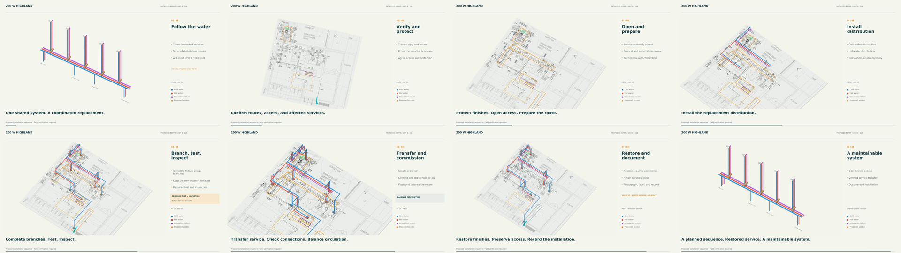

# Highland — proposed installation animation

The 90-second film follows shared distribution into the **Unit B / 106 pilot**: verify and protect, open access, install replacement piping, test and inspect, transfer service, then restore and document.

- [Watch/download the 1080p film](assets/Highland-repipe-90s-1080p.mp4)
- [Download the 4K master](assets/Highland-repipe-90s-4K.mp4)
- [Eight-page storyboard](assets/Highland-repipe-storyboard.pdf)
- [Editable animation, audio and source models](assets/Highland-repipe-animation-editable.zip)
- [Original installation models and source drawing package](assets/Highland-installation-model.zip)
- [Narration captions](../../projects/highland-installation/animation-90s/Highland-repipe-90s.srt)
- [Source, restoration instructions and validation](../../projects/highland-installation/README.md)

The five large files use Git LFS. On GitHub, choose **Download raw file** if a preview is unavailable. For a local checkout, run `git lfs pull`; the source project README explains how to restore the editable folder structure.

All new physical geometry remains assumed and requires field verification. Testing, inspection and commissioning are proposed future activities. The 4K film uses upscaled model imagery with native 4K graphics; full production details are in the project README. This pilot is distinct from the earlier Unit A / 107 study.
