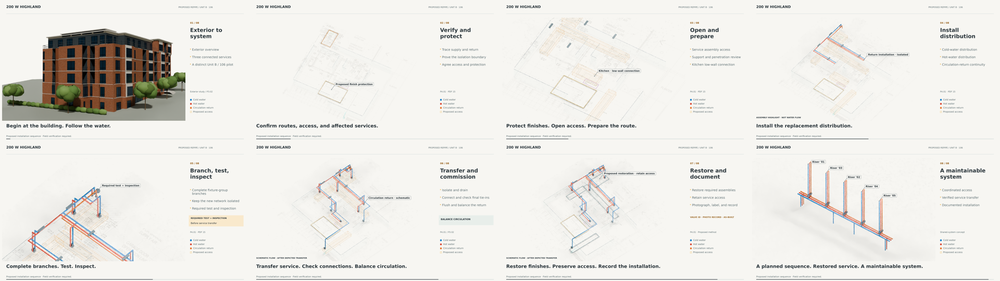

# Corrected script integration — reviewed rig and stills

The supplied replacement scripts are integrated with the exterior-first studio treatment. This delivery contains a tested editable rig and eight review stills. The existing 90-second film is unchanged; a fresh full-length movie export is not included.

- [Corrected scripts, editable rig and complete rebuild inputs](Highland-corrected-rebuild-review.zip)
- [Editable Blender master](Highland-repipe-90s.blend)
- [Eight-frame preview](storyboard-preview-contact.png)
- [Native exterior opening check](editable-exterior-check.png)
- [Native test-stage composition check](editable-master-check.png)
- [Changes, dependencies and rebuild commands](REBUILD-NOTES.md)
- [Original geometry and timing gates](blender-validation.json)
- [51 presentation checks](presentation-validation.json)
- [Interpolation, color and audio smoke checks](pipeline-smoke-validation.json)
- [Archive integrity](package-validation.json) · [Review scope](review-scope.json)

The original finalizer compared all **94 unit and 45 shared objects**, and passed every specified timing assertion and all eight scene-strip ranges. Both original gate scripts remain byte-for-byte unchanged. Additional QA checks each exported screen-space anchor, camera continuity, source dimensions and nested VSE channels. The highest channel is **63**. The native opening was reviewed after correcting a meta-strip prehold that had displayed shared-system labels too early.

The preview model imagery is **960 × 540 at four Cycles samples**, composited into 4K storyboard frames. Those frames are individual stills. Full-movie codec/runtime/native-frame-coverage gates must run after a complete new export. The complete folder tree in the ZIP includes the studio module, 400-DPI blueprint, HDRI and original exterior/installation inputs required by the corrected scripts.

Large `.blend`/`.zip` files use Git LFS. Choose **Download raw file** on GitHub if preview is unavailable. Original field-verification and assumed-geometry limitations remain in effect.
