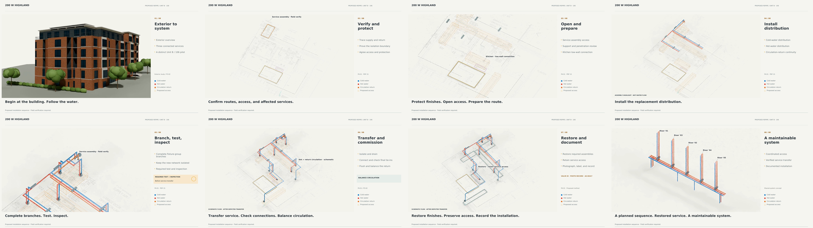

# Highland — studio treatment review

The revised **90-second review starts outside the existing exterior model**, dissolves into shared distribution, then follows the Unit B / 106 installation. It prioritizes spatial depth with a quiet 25% warm-gray drawing, low ghost walls, shaded coated pipes and soft shadows. Continuous camera drift, kitchen/service focus moves, horizontal labels, dashed access volumes, proposed valve-closing icons and post-transfer flow cues carry the sequence.

- [Watch/download the 1080p review](Highland-repipe-studio-90s-1080p.mp4)
- [Upgrade guide (PDF)](Highland-studio-upgrade-guide.pdf) · [Readable Markdown version](UPGRADE-GUIDE.md)
- [Editable Blender studio variant](Highland-studio-upgrade.blend)
- [Scripts, editable scenes and rebuild inputs](Highland-studio-upgrade-editable.zip)
- [Eight-frame storyboard PDF](Highland-studio-storyboard.pdf)
- [Uncompressed PNG color reference](Highland-studio-color-reference.png) — exact #F7F6F2 paper outside the rendered content.
- [Source scripts and configuration](../../../projects/highland-installation/studio-upgrade/README.md)
- [Blender checks](studio-validation.json) · [Delivery checks](delivery-validation.json) · [File hashes](delivery-files.json)
- [Visual review record](VISUAL-REVIEW.md) · [Media portability and color checks](media-validation.json)

The downloadable review uses **960 × 540 Cycles imagery, four samples and two native scene frames/second**, denoised and interpolated to 24 fps, with sharp 1080p editorial graphics. The drawing and faint context fills are camera-projected separately to preserve clean linework. This is a look-development review. The guide and editable 24 fps rig include native 4K production-render settings.

Large downloads use Git LFS; choose **Download raw file** on GitHub if a preview is unavailable. Keep the ZIP's folder structure intact for rebuilding. The original delivery remains available in the parent folder.

All new physical geometry remains assumed. Ghost-wall heights and access-volume depths are display choices. Valve icons depict proposed operations that require field verification. Tests and inspections are future release conditions, and flow cues are schematic. The original installation source geometry and files remain unchanged.
