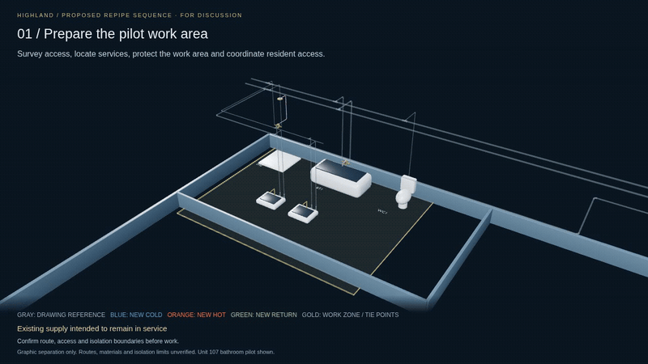

# Highland — proposed repipe strategy

**Install new piping alongside the existing system, then cut over one unit at a time.** The animation uses Unit 107 and its bathroom pilot to show installation, testing, cutover, service verification and restoration before moving to the next unit.

- [Watch/download the 32-second animation](Highland-repipe-strategy.mp4) — choose **Download raw file** if GitHub does not play it.
- [Interactive sequence](Highland-repipe-sequence.html) — download the raw file, then open it in a browser. Play, pause, scrub or select a phase.
- [Sequence assumptions and reproduction instructions](../../projects/highland-repipe/README.md)
- [Validation record](validation.json)

This is a **proposed sequence**. Gray pipes are the drawing reference, not verified installed conditions. Colored routes reuse that topology with graphic separation; final routing, materials, access and isolation boundaries remain to be established. The nine bathroom tie points illustrate the unit cutover. Other connections and shared-building work are not resolved by this animation. Shared mains remain shown until all their users are verified.
