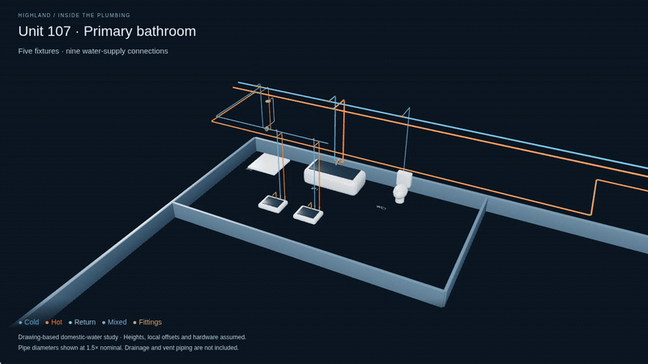

# Highland — actual pipe geometry, working model

This is the corrected starting point: modeled domestic-water pipes, fixtures and equipment. Unit 107 plan scale now derives from the architectural structural grid, and floor datums follow A3.11. Start with the updated review PDF, including a bathroom close-up and calibration evidence.

- [Proposed repipe strategy — installation and unit-by-unit cutover](../highland-repipe/)
- [Animated plumbing view — 24-second MP4](Unit-107-plumbing-animation.mp4) — bathroom orbit, fixture connections, then full-unit context. Use **Download raw file** to play locally if GitHub does not preview it.
- [Bathroom pilot PDF — two pages](Unit-107-bathroom-pilot.pdf) — the five fixtures and their supply connections.
- [Model review PDF](Highland-pipe-model-review.pdf)
- [Interactive 3D model](Highland-plumbing-3D.html) — use **Download raw file**, then open the downloaded HTML in a browser. GitHub shows HTML source rather than running it. All models and code are embedded.
- [Drawing-overlay review](Unit-107-trace-review.html) — download and open in a browser; toggle the modeled routes over P4.01.
- [Editable Blender model](Highland-domestic-water.blend) — contains building, plant and unit collections. Opens on the Unit 107 bathroom. Hide the unit collection and unhide building or plant to review the other studies.
- GLB models: [Unit 107](unit.glb), [building distribution](building.glb), [boiler plant](plant.glb).
- [Source sheets P2.02, P3.02, P4.01, A2.03 and A3.11](Source-reference-sheets.pdf)
- [Validation results](validation.json) and [full scope, assumptions and reproduction instructions](../../projects/highland-water/README.md).

[Still bathroom view](Unit-107-bathroom-preview.png)

[Fixture connection close-up](Unit-107-connections-preview.png) · [Full-unit view](Unit-107-preview.png)

**Unit 107 plan XY is provisional; building floor datums are documented. Pipe heights, building stack XY and fixture/equipment envelopes remain assumed.** Source pipe sizes and connection patterns are recorded separately from geometry assumptions. The viewer opens on the bathroom; use **Connections** for fixture stops and supply connectors, and **Fittings** to toggle hardware. Nine fixture supply ports and two mixed outlets are checked; hardware, wall-side offsets and heights remain representative. The model covers domestic water; sanitary, vent and gas are not included. It is a working model study, not an as-built or a dimensionally verified owner presentation. See the review PDF's final page for the next required dimensions and unresolved connections.

The previous [sheet-stack tour](../highland/) is superseded as the approach to this task. The new animation shows the modeled domestic-water geometry, with assumptions labeled throughout.
