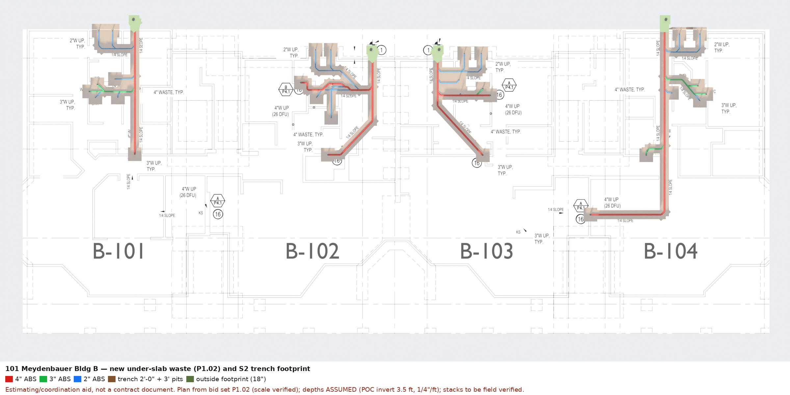

# 101 Meydenbauer Bldg B: under-slab re-pipe bid model and slab-allowance check

KEAD 25-048. Bid due **Thu Oct 30, 2026, 5:00 PM**. Estimating and coordination aid; not a
contract document. Method, provenance and reproduction:
[projects/meydenbauer-b](../../projects/meydenbauer-b/README.md).

## Bottom line

The 700 SF slab allowance (Allowance No. 7) matches the drawn routes at the detailed 2'-0" trench,
with almost no margin. The quantity risk is **depth**, and the documents leave depth open.

| Case (all four units) | Slab cut | vs 700 SF | Excavation (bank) |
| --- | ---: | ---: | ---: |
| S1: 2'-0" trench only (10/P5.1) | 590 SF | −110 | 72 CY @ 3.5 ft POC invert |
| S2: S1 + 3'×3' pit at each of 30 fixture/stack connections | **686 SF** | **−14** | **82 CY** (103 CY loose) |
| S3 @ 4.5 ft POC invert: 4'-0" wide wherever trench ≥ 4'-0" | 991 SF | **+291** | 158 CY |

- **312.7 LF** of new under-slab ABS: 105 LF of 2", 33 LF of 3", 175 LF of 4". The building
  drain is ≈56% of the run. B-104 is the largest unit (96.5 LF, 215 SF of slab in S2).
- POC inverts are not documented ("MATCH EX. I.E."). The SOR's recorded depths are 2½–4½ ft. If
  the invert at a POC is deeper than about **3.7 ft**, the trench there is ≥ 4 ft deep. At 4.5 ft,
  294 of 313 LF is ≥ 4 ft. Trench protection then widens the cut, which drives S3. Verify the WA
  DOSH threshold in WAC 296-155 Part N.
- The SOR states a **high water table** relative to the slab. No dewatering requirement,
  allowance or unit price appears anywhere in the bid documents.
- At the 3.5 ft base case, about 100 CY of loose spoil goes out through occupied units, and about
  the same volume of bedding and backfill comes back in. Water and sewer service must be restored
  daily by 5:00 PM (SOR General Note 21).

Per unit, base case S2 at a 3.5 ft POC invert:

| Unit | Pipe LF (2"/3"/4") | Connections | Slab SF | Bank CY | Fall on longest run |
| --- | --- | ---: | ---: | ---: | ---: |
| B-101 | 66.2 (23.8 / 12.4 / 30.0) | 8 | 152 | 18.7 | 0.63 ft |
| B-102 | 85.2 (37.7 / 0 / 47.5) | 7 | 174 | 20.9 | 0.61 ft |
| B-103 | 64.8 (23.6 / 2.0 / 39.2) | 7 | 145 | 18.1 | 0.57 ft |
| B-104 | 96.5 (19.6 / 18.4 / 58.5) | 8 | 215 | 24.6 | 1.22 ft |
| **Total** | **312.7** | **30** | **686** | **82.3** | |

## Document conflicts and draft RFIs

SOR General Note 24 reads "All RFI's shall be issued to KEAD within 5 business days of the
deadline for bids". Counted back from Oct 30, that is **Fri Oct 23, 2026**. Treat today as the
cutoff unless KEAD says otherwise. The RFI form is Document 00 63 13.13.

1. **POC inverts and trench depth.** P1.02 keynote 1 says "MATCH EX. = I.E.", and no inverts are
   given. Please provide the existing invert elevation, or depth below finished floor, at each of
   the four 2-way cleanout tie-ins. If they are unknown, confirm that trench depth beyond ___ ft and
   any required protective system will be adjusted by change order. Depth determines whether the
   trench stays at the 2'-0" width in 10/P5.1.
2. **Allowance No. 7 measurement.** Confirm that the 700 SF is measured as plan sawcut area.
   Confirm whether it includes openings at fixture drains, carriers and stack bases, and any extra
   width a trench protective system requires. Confirm that Unit Price No. 7 applies both ways.
3. **Groundwater.** SOR "Initial Investigation" states a high water table relative to the
   Building B slab. Confirm whether dewatering, and disposal of pumped water, is in the base bid.
   If it is, state the basis to assume. If not, provide a unit price or allowance.
4. **B-104 previously replaced run.** P1.02 shows new 4" waste from about grid 3 to riser A at the
   B-104 kitchen: about 30 LF, and about 70 SF of slab in the EHF-2 area. P3.2 labels this run
   "PREVIOUS REPLACED 4" SCHEDULE 40 ABS USED FOR REPAIR". P1.01 clouds the B-104 kitchen with
   "...associated piping shall remain". The SOR mentions a prior repair only in B-101. Confirm
   whether this run is replaced or remains, as the B-101 run does.
5. **Addendum 1 dates.** Document 00 91 13 states "Date of Addendum: October 16, 2024" and "Bid
   Date: October 30, 2024". Confirm that the Invitation to Bid date, October 30, 2026 at 5:00 PM,
   governs.

## Files

| File | Use |
| --- | --- |
| `Meydenbauer-B-underslab-takeoff.xlsx` | Summary across all 9 cases, per-unit sheet, every run with ID and size, and an *Inputs* sheet with status and source. Blue cells are measured or assumed inputs; black cells are formulas. |
| `Meydenbauer-B-underslab.blend` | Editable model. The P1.02 underlay is packed in. Collections: slab, trenches, pipe, risers. |
| `Meydenbauer-B-underslab.glb` | Phone and web viewing. Each pipe carries unit, size, OD, length, status and source. |
| `present-plan.png`, `present-iso*.png` | Pipe colored by size; trench footprint S2 |
| `review-plan.png`, `review-iso.png` | Colored by provenance (provisional/assumed) |
| `takeoff.json`, `model-checks.json` | Machine-readable quantities and model checks |

## What was verified

- **Scale** of P1.02 against the grid dimension strings: 8.998 and 9.009 pt/ft against 9.0.
- **Extracted routes** against the sheet: each unit was overlaid and checked by eye.
- **Model checks** pass: 136 runs, 312.75 LF, 4 POCs, depth band.
- **Renders** were inspected.

## Not verified

- Routes against field conditions. KEAD calls the drawings diagrammatic, and stacks are to be
  field verified.
- All depths.
- Room-by-room finish areas. The trench is not yet mapped to the finish codes behind Allowances
  1–6 and 8.
