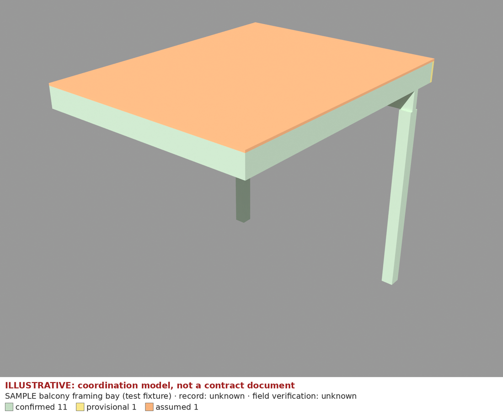

# Getting started: build and verify a synthetic model

A 15-minute first run with **no real project data**. You build the repo's fictional sample, then make a disposable copy,
change one element's provenance, and watch the checks react. Everything here is **synthetic and illustrative — not a
contract document**.

Rules behind it: [METHOD.md](METHOD.md). Full command reference: [RUNBOOK.md](RUNBOOK.md). Agents:
[../AGENTS.md](../AGENTS.md) and the [model-from-drawings skill](../.claude/skills/model-from-drawings/SKILL.md).
Supported Blender/Python versions: [BLENDER_VERSION.md](BLENDER_VERSION.md).

## 1. Set up

```bash
uv sync --frozen        # Python 3.11 + locked bpy 5.0.1; the first run downloads a large wheel
uv run bm doctor        # must show: ok python 3.11, ok bpy imports, ok uv.lock matches
```

Linux needs the X11 libraries listed in the [README](../README.md#quickstart). Other `MISS` lines in `bm doctor`
(GPU, source PDFs, LFS) do not block this walkthrough. Renders use Cycles on CPU; there is no GPU requirement.

## 2. Build the canonical sample

`projects/sample/specs/sample-bay.yaml` is a fictional balcony framing bay (a CI fixture; do not edit it).

```bash
uv run bm build sample/sample-bay --no-render   # checks only, fast
uv run bm build sample/sample-bay               # checks + review renders (about a minute on the machine used for the 2026-11-08 run)
```

Expected: `**PASS** — 20/20 checks` (11 confirmed, 1 provisional, 1 assumed element) and, in
`build/sample/sample-bay/`: `report.md`, `report.json`, `.blend`, `.glb`, and four review PNGs. `build/` is git-ignored.

Read `report.md`. It lists each check with its expected and actual value and `source`, the elements that are
assumed, and a **Visual review** section. That section says `NOT RECORDED` until a person looks at the renders and
records it in the spec's `review:` block. Passing checks is not a visual review.

Then open the PNGs. Each carries a strip under the image: "ILLUSTRATIVE: coordination model, not a contract document",
the record kind, the field-verification status and the provenance counts. Colors: green confirmed, yellow provisional,
orange assumed.



More in [media/README.md](media/README.md).

## 3. Make a disposable site and change one provenance status

`bm new` copies a starter spec into `projects/<site>/`. This starter is the same fictional bay as the sample.

```bash
uv run bm new onboarding-demo --name "SYNTHETIC onboarding demo" --type element
uv run bm build onboarding-demo --no-render      # 20/20 checks
```

In `projects/onboarding-demo/specs/onboarding-demo-element.yaml`, change the `rim` element from provisional to assumed
**without** a basis, and leave its size and position alone:

```yaml
  - id: rim
    size: [97.5, 1.5, 9.25]
    at: [0, 121.5, 96]
    status: assumed          # was: provisional + source: S2
```

```bash
uv run bm build onboarding-demo --no-render
```

Expected: `SPEC INVALID: rim: assumed elements need a 'basis' explaining the assumption`, `0/1 specs passed`, exit code 1.
The pipeline refuses unexplained assumptions. Now add the basis:

```yaml
    status: assumed
    basis: "Rim joist not on S1; same size as the ledger assumed for massing only"
```

```bash
uv run bm build onboarding-demo          # with renders
```

Expected: `**PASS** — 20/20 checks`, provenance `{'confirmed': 11, 'assumed': 2}`, `rim` listed under
**Assumed (not from documents)** in `report.md`, and the render legend reading `confirmed 11 · provisional 0 · assumed 2`
with the rim end turning orange. Geometry and checks are unchanged because only the label changed.

Rules this demonstrates: every element is `confirmed` (with `source`), `provisional` (with `source`, reference and
tolerance) or `assumed` (with `basis`). Never present assumed geometry as documented.

## 4. Clean up

The demo is disposable. Do not commit it:

```bash
rm -rf projects/onboarding-demo build/onboarding-demo
git status --short        # nothing from the demo should remain
```

## 5. Real work

Real projects start the same way but the spec comes from drawings: follow the
[model-from-drawings skill](../.claude/skills/model-from-drawings/SKILL.md) and METHOD.md (actual lumber sizes, never scale
an NTS detail, calibrate each sheet from its own dimension strings, model the governing document when sources
conflict, existing-conditions and proposed-repair as separate specs). Before finishing: `uv run bm check`.

Walkthrough last run: 2026-11-08 (`bm doctor`, both builds with and without `--no-render`, failure case and fix; renders
viewed).
