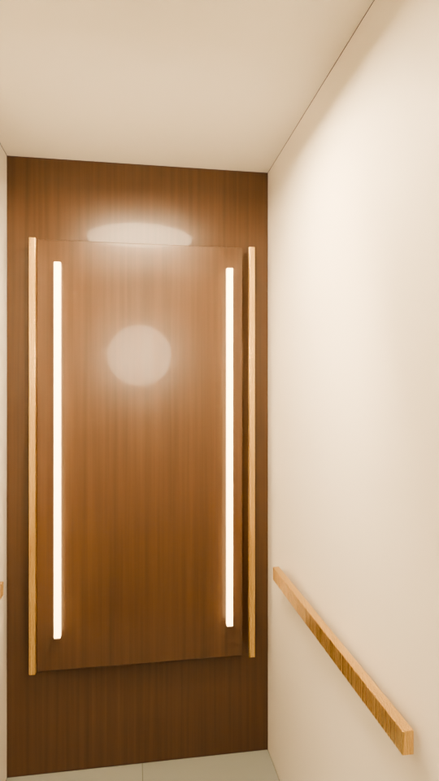

# Highland / upgraded full walkthrough

[Watch the upgraded MP4](../blender-film/Highland-Blender-walkthrough.mp4?raw=true) · [Matching animated Blender scene](../blender-film/Highland-walkthrough.blend?raw=true)

The entire **26-second** tour now uses the upgraded Cycles lighting, materials and planting. The MP4 is **540 × 960 / 24 fps with stereo audio**; the GIF previews all 26 seconds at 8 fps without sound. Doors open on approach, the elevator rises from R1 to R2, and the glass-and-brass section leads back to Corridor 208. Finishes and unverified details remain illustrative.

The stills below compare this visual treatment with the previous study at matching frame numbers. They use 24 samples; the full animation uses 16 samples with denoising.

## Lobby

[Compare the previous study and upgraded lobby](Compare-lobby.jpg)

## Exterior

[Compare exterior lighting and planting](Compare-exterior.jpg)

## Elevator

[Compare elevator finishes](Compare-elevator.jpg)

## Upper corridor

[Compare carpet, door finishes and wall lighting](Compare-corridor.jpg)

## Scene, sources and verification

Use the [matching film scene](../blender-film/Highland-walkthrough.blend?raw=true) in Blender 5.0.1 or newer. It includes the revised cutaway transition, packed CC0 Poly Haven HDRI and packed soundtrack. The earlier [still-review scene](Highland-archviz.blend?raw=true) remains available for the four preview images.

[Full-film review sheet](../blender-film/Highland-Blender-full-review.jpg) · [Playback checks](../blender-film/playback-validation.json) · [Native camera checks](../blender-film/Highland-walkthrough.validation.json) · [Film provenance](../blender-film/media-validation.json)

The model retains drawing-based circulation and the 123-inch R1-to-R2 rise. Planting, warm window back panels, furniture, finishes, facade details and fixture optics are illustrative. No manufacturer IES profiles or paid botanical libraries are included. Nearby massing uses [© OpenStreetMap contributors](https://www.openstreetmap.org/copyright) / ODbL 1.0, with approximate placement and heights. [HDRI source and license](../../../../assets/hdri/README.md) · [Still-image provenance](review-manifest.json) · [Build and render instructions](../../products/walkthrough/BLENDER.md)
