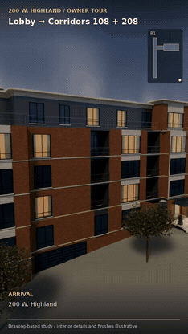

# Highland / upgraded Blender walkthrough

[Watch the full MP4](Highland-Blender-walkthrough.mp4?raw=true) · [Download the matching Blender scene](Highland-walkthrough.blend?raw=true) · [Phone gallery and comparisons](../archviz/README.md)

The complete 26-second walkthrough is rendered in native Blender Cycles at **540 × 960, 24 fps**, with denoising, AgX, subtle bloom, captions, location map and stereo AAC sound. The GIF above previews the entire tour at 8 fps without audio; use the MP4 for full motion and sound.

The film includes HDRI lighting, individual leaf canopies, warm curtained windows, entrance handrails and planting, lobby furniture and art, tile grout, fine wood grain, woven carpet and wall accent lighting. Opening doors, the moving elevator and the glass-and-brass architectural section remain native animation. The camera keeps the cab feature in view until the section pullback, then returns to Corridor 208.

Open the scene in **Blender 5.0.1 or newer** and play frames 1–624. HDRI and sound are packed. The floor datums and circulation follow the drawings; finishes, furniture, planting, facade details and nearby massing remain illustrative.

Sky: [Poly Haven / CC0](../../../../assets/hdri/README.md). Surrounding massing: [© OpenStreetMap contributors](https://www.openstreetmap.org/copyright), ODbL 1.0, with approximate registration and assumed heights.

- [Poster](Highland-Blender-poster.png)
- [Elevator section](Highland-Blender-section.png)
- [Timed full-film review sheet](Highland-Blender-full-review.jpg)
- [Native camera and door checks](Highland-walkthrough.validation.json)
- [Decoded video, audio and playback checks](playback-validation.json)
- [Render provenance](media-validation.json)
- [Rebuild and Actions instructions](../../products/walkthrough/BLENDER.md)
