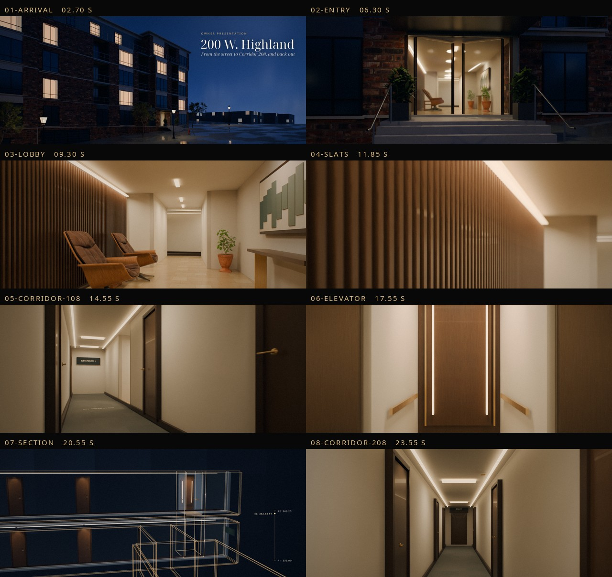

# Highland / cinematic owner film (1080p)

**[Watch the film (MP4, 1920 × 1080, 33 s, 43 MB)](https://github.com/michaelcolenso/blender-models/releases/download/highland-cinema-1080p-2026-11-08/Highland-cinema-1080p.mp4)**
· [Section reveal GIF (4.8 MB)](https://github.com/michaelcolenso/blender-models/releases/download/highland-cinema-1080p-2026-11-08/Highland-cinema-section.gif)
· [Release page](https://github.com/michaelcolenso/blender-models/releases/tag/highland-cinema-1080p-2026-11-08)

A 29-second, 2.39:1 owner film with an end card, cut from the native Blender walkthrough into nine composed
shots. It runs from the dusk street through the entry, Lobby 110 and Corridor 108 to Elevator M1, then an x-ray
section of the R1 to R2 rise and Corridor 208, before returning outside. It was rendered in Cycles on a RunPod
GPU (RTX 6000 Ada, `final` profile: 1920 × 804 picture, 128 samples, 702 frames). It was then graded, titled
and scored with an original synthesized soundtrack.

| Stills | |
|---|---|
| [Title](stills/01-title.jpg) · [Entry](stills/02-entry.jpg) · [Lobby 110](stills/03-lobby.jpg) · [Slat wall](stills/04-slats.jpg) | [Elevator M1](stills/06-elevator.jpg) · [Section R1 → R2](stills/07-section.jpg) · [Corridor 208](stills/08-corridor-208.jpg) · [Release](stills/09-release.jpg) |

**Illustrative, not a contract document.** The floor datums (R1 353.00 / R2 363.25 ft) and the circulation
come from the drawings listed in the [product README](../../../products/walkthrough/README.md). Everything else
is a presentation treatment and must not be read as documented. That covers:

- the dusk lighting, wet pavement, street lights and lit windows;
- the finishes, furnishings, hardware, planting and the walnut slat wall;
- the street trees, lamps and hydrant;
- the elevator car, its door timing and the x-ray section;
- the neighbouring massing ([© OpenStreetMap contributors](https://www.openstreetmap.org/copyright), ODbL 1.0,
  approximate heights).

Textures and models are Poly Haven CC0.

## Checks

[`validation.json`](validation.json) records the following:

- the frame count (792 at 24 fps), size, codecs and duration;
- loudness of −15.9 LUFS with a −4.8 dBTP true peak;
- no blank shots;
- the MP4's sha256.

[`cinema-validation.json`](cinema-validation.json) records the camera clearance and smoothness for each shot.
The release checksums are in [`release-assets.json`](../../../products/walkthrough/release-assets.json).

## Rebuild

See [CINEMA.md](../../../products/walkthrough/CINEMA.md) (profiles and steps) and
[RUNPOD.md](../../../products/walkthrough/RUNPOD.md) (GPU render). In short:
`cinema.py --validate`, then `runpod_render.sh render final`, then `cinema_finish.py --profile final`.
