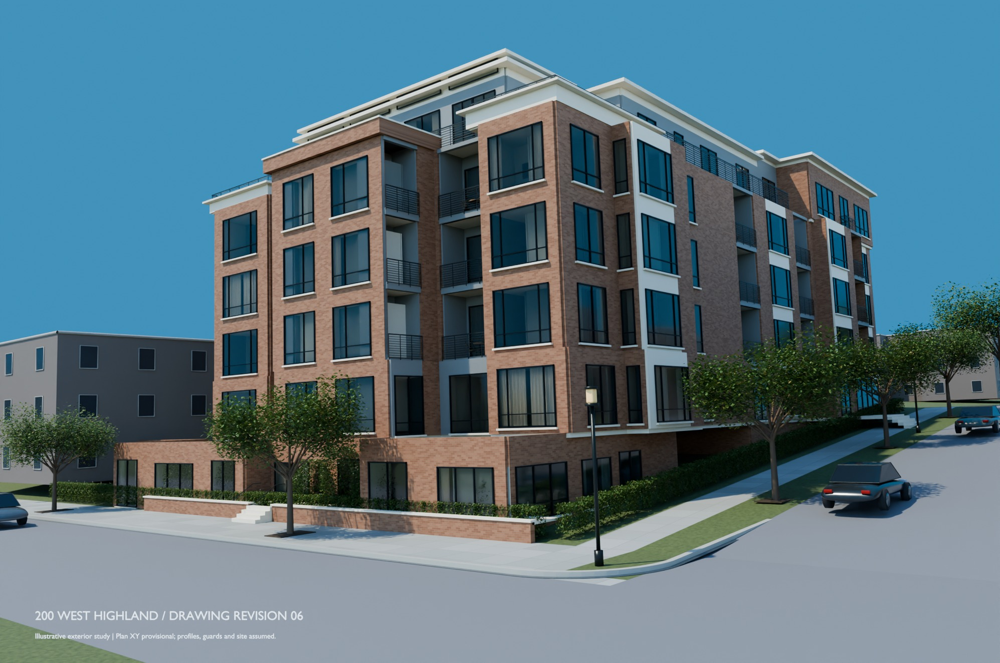
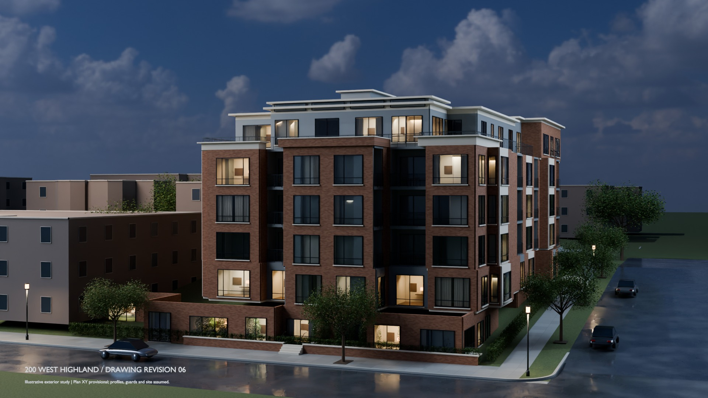

# Highland exterior — drawing reconciliation, revision 06

**Illustrative, not a contract document.** This is a coordination model, not a
verified as-built or construction model:
- plan XY positions are provisional;
- complete window profiles, sill and head dimensions, guards, sections and site
  context are assumed;
- the north stair/MU alignment and R1 north entries remain deferred at the
  owner's request.

## Files

Large files are on release
[`highland-exterior-reconciliation-2026-11-05`](https://github.com/michaelcolenso/blender-models/releases/tag/highland-exterior-reconciliation-2026-11-05).
Their checksums are in [release-assets.json](../../products/exterior-reconciliation/release-assets.json).
Restore and verify them with
`uv run bm assets pull projects/highland/products/exterior-reconciliation/release-assets.json`.

| File | What it is |
|---|---|
| [Highland-drawing-reconciled.blend](https://github.com/michaelcolenso/blender-models/releases/download/highland-exterior-reconciliation-2026-11-05/Highland-drawing-reconciled.blend) (24 MB) | Editable native scene: daylight and dusk scenes, 432-frame dusk camera, packed textures |
| [Highland-drawing-reconciled.glb](https://github.com/michaelcolenso/blender-models/releases/download/highland-exterior-reconciliation-2026-11-05/Highland-drawing-reconciled.glb) (20 MB) | Portable model; per-object provenance in glTF extras |
| [element-provenance.csv](https://github.com/michaelcolenso/blender-models/releases/download/highland-exterior-reconciliation-2026-11-05/element-provenance.csv) (1.8 MB) | Every object's status (`confirmed` / `provisional` / `assumed`), source and basis |
| [Highland-drawing-reconciliation-rev06-review.pdf](https://github.com/michaelcolenso/blender-models/releases/download/highland-exterior-reconciliation-2026-11-05/Highland-drawing-reconciliation-rev06-review.pdf) (33 MB) | The archived revision 06 review report: source/model comparisons per elevation, R5 and terrace review. Published unchanged, not regenerated |
| [previews/](previews/) | JPEG stills and 12 geometry review views (orange = complete components assumed) |
| [delivery-validation.json](delivery-validation.json) | Mesh readback of the published `.blend` and `.glb` |
| [native-check.json](native-check.json), [source-check.json](source-check.json) | Rebuild and source checks (below) |
| [render-records.json](render-records.json) | Render settings and image hashes, tied to the verified geometry |

## How it was made and checked

The [exterior-reconciliation product](../../products/exterior-reconciliation/README.md)
rebuilds this model from the recovered revision 06 inputs. On every change, CI
reruns the rebuild and then:
- compares all 960 architecture meshes with the historical delivery records; they
  must be identical, including the 97 north, 815 revision 05 and 99 R5 protected
  controls;
- reads the saved meshes back: opening extents, wall normals, slab
  areas/perimeters, coping, terraces and all 432 camera frames.

The published `.blend`, `.glb` and CSV are the files CI rebuilt and validated at
`489972a` (run 41956248786).

I rendered the stills and review views on CPU from the same geometry. Their
architecture inventory hash, `69e546b6…`, matches the CI model's. I compared them
with the stills delivered with the historical revision 06 package:
- in the daylight still, 0.000% of pixels differ by more than 8 levels; in the
  dusk still, 0.008%;
- the review views differ by Cycles sampling noise only, at most 0.09% of pixels.

Identical hashes show that this is the delivered revision 06 geometry. They do not
show that the geometry is dimensionally accurate, or that it matches installed
conditions.

Rebuild: `uv run bm run highland/exterior-reconciliation check`, then `render`
and `package` (see the product README).
