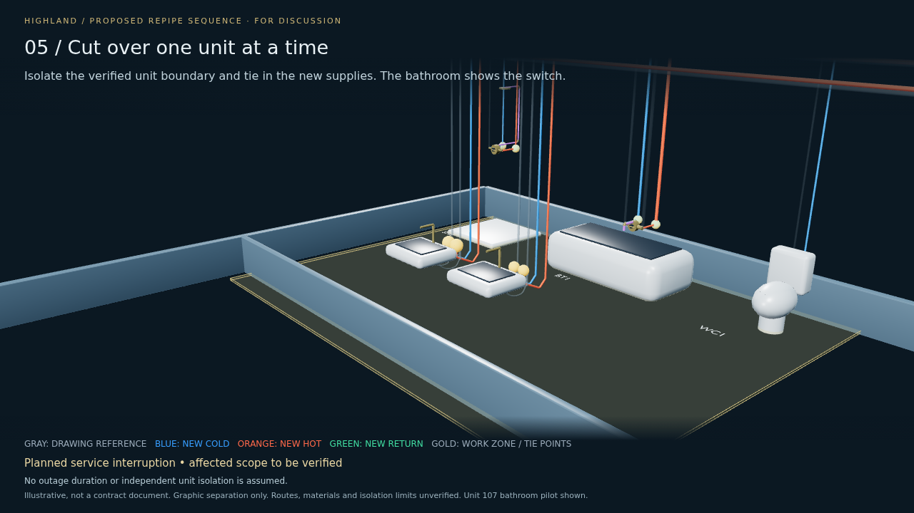

# Highland — proposed repipe strategy

**Install new piping alongside the existing system, then cut over one unit at a time.** The animation uses Unit 107 and its bathroom pilot to show installation, testing, cutover, service verification and restoration before moving to the next unit.

**Illustrative, not a contract document.** A proposed sequence for discussion, not a contractor-approved means-and-methods plan.



## Downloads

Rebuilt 2026-11-04 from the water model's current assumed pipe heights (CW 108 / HW 106 / HWC 104 in). Large files are on the [`highland-repipe-2026-11-04` release](https://github.com/michaelcolenso/blender-models/releases/tag/highland-repipe-2026-11-04); checksums are in [`release-assets.json`](../../products/repipe/release-assets.json).

- [32-second animation (MP4)](https://github.com/michaelcolenso/blender-models/releases/download/highland-repipe-2026-11-04/Highland-repipe-strategy.mp4) and its [animated preview (GIF)](https://github.com/michaelcolenso/blender-models/releases/download/highland-repipe-2026-11-04/Highland-repipe-preview.gif).
- [Interactive sequence](https://github.com/michaelcolenso/blender-models/releases/download/highland-repipe-2026-11-04/Highland-repipe-sequence.html) — download, then open in a browser. Play, pause, scrub or select a phase.
- [Validation record](validation.json) — sequence checks and the full-decode result.
- [Sequence assumptions and reproduction instructions](../../products/repipe/README.md)

## What is shown, and what is not

This is a **proposed sequence**. Gray pipes are the drawing reference from the [water model](../water/), not verified installed conditions; that model's Unit 107 ceilings are provisional and its pipe heights are assumed. Colored routes reuse that topology with graphic separation; final routing, materials, access and isolation boundaries remain to be established. The nine bathroom tie points illustrate the unit cutover. Other connections and shared-building work are not resolved by this animation. Shared mains remain shown until all their users are verified.

## Rebuild

```bash
uv run bm run highland/repipe prepare
uv run bm run highland/repipe package
uv run bm run highland/repipe video
```

These need the water product's `build` and `viewer` steps first; see the [product README](../../products/repipe/README.md).
