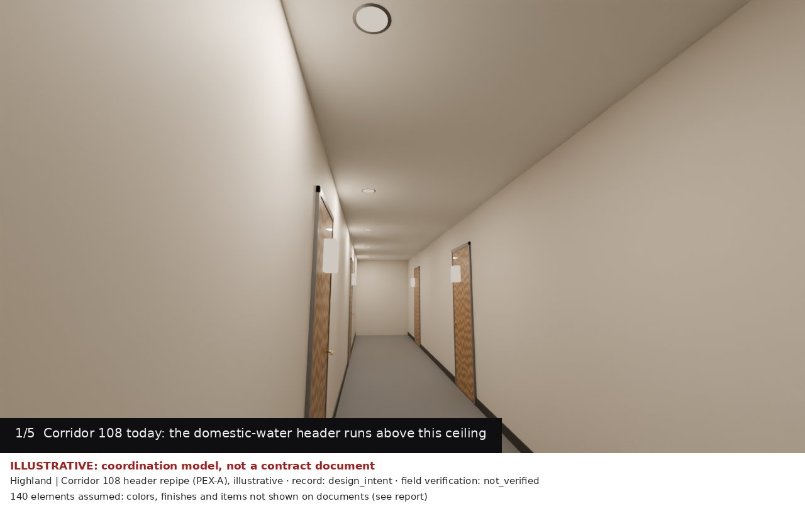
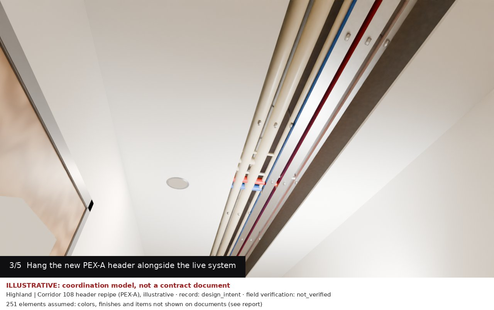
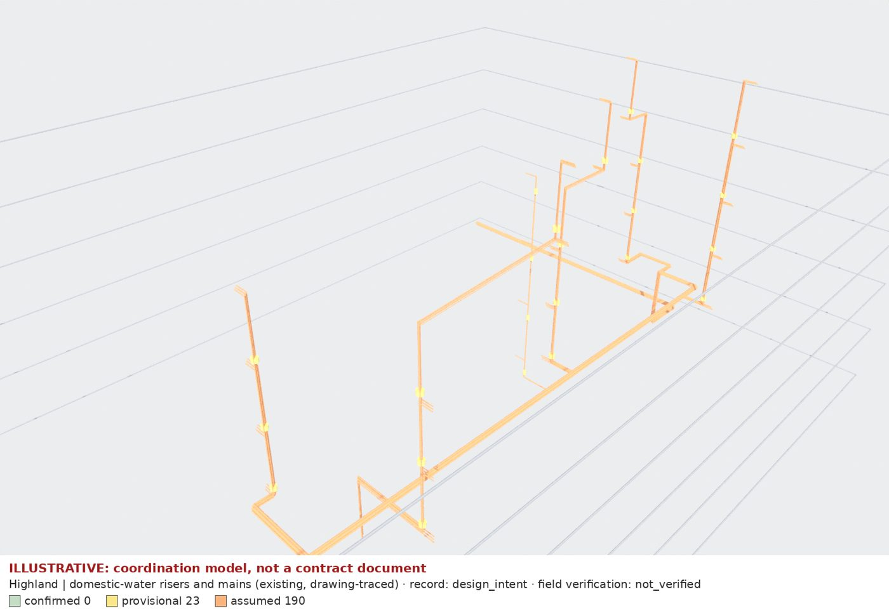
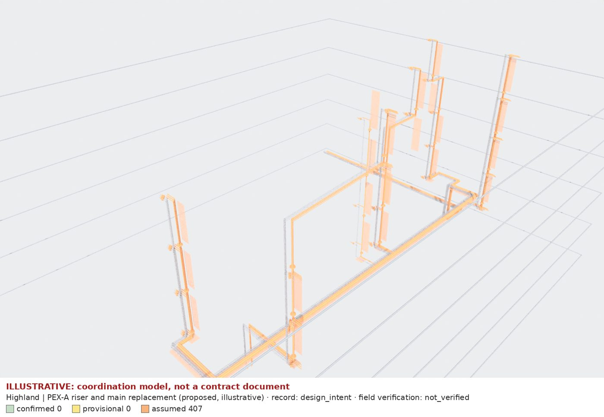

# Highland domestic-water risers and mains: existing model, PEX-A proposal and work sequence

**Illustrative, not a contract document.** A coordination model traced from the October 2007 plumbing set, not
a survey of installed piping. Every proposed element is assumed, and none of it is engineered.

How it was built, and every source, assumption and flag: [products/risers](../../products/risers/README.md).

## Work sequence (Corridor 108 header, CPU preview)



| Phase | Wide | Detail |
|---|---|---|
| 1. Before | [wide](01-before-wide.jpg) | [detail](01-before-detail.jpg) |
| 2. Protect and open a 24 in ceiling strip | [wide](02-open-wide.jpg) | [detail](02-open-detail.jpg) |
| 3. Hang the new PEX-A header alongside the live CPVC | [wide](03-install-wide.jpg) | [detail](03-install-detail.jpg) |
| 4. Test, then cut over stack branches during a scheduled shutdown | [wide](04-cutover-wide.jpg) | [detail](04-cutover-detail.jpg) |
| 5. Patch, tape, paint; remove protection | [wide](05-restore-wide.jpg) | [detail](05-restore-detail.jpg) |



These are 1280 × 720 CPU previews at 64 samples. The full-quality 4K set renders on RunPod with
`runpod_photoreal.sh`.

- **From the model:** pipe routes, sizes and the C and D branch takeoffs.
- **Illustrative:** the corridor finishes, doors, lights, hangers, protection and equipment.
- **Pending:** the finishes will be matched to site photos once they are added.

## Coordination model

| Existing (drawing-traced) | Proposed PEX-A (grey: existing) |
|---|---|
|  |  |
| [plan](existing-plan.jpg) · [south](existing-south.jpg) · [east](existing-east.jpg) · [report](existing-report.md) | [plan](proposed-plan.jpg) · [south](proposed-south.jpg) · [east](proposed-east.jpg) · [report](proposed-report.md) |

Review renders color elements by provenance (yellow provisional, orange assumed) and draw pipes at 2× outside
diameter.

- **Existing:** 214 elements; plan XY is provisional, with pipe heights assumed (no drawing gives them). All
  12 document and graph checks pass, the network check included.
- **Proposed:** 407 elements, all assumed; the PEX-A network is checked to be fully connected.

## What still needs a person

- **Pipe heights and chase space:** no document gives them. A walk-through of Corridor 108 and one chase per
  stack would turn the assumed heights and offsets into measurements.
- **Units 106/107 drop HW size:** P2.03 shows 1½", P3.02 shows 1¼". Which governs?
- **Stack numbering:** which plan stacks are P3.02's 01, 02, 04 and 05, and which of A, B, C and E lacks an R1
  branch.
- **Engineering:**
  - PEX-A sizing, because PEX-A has a smaller bore than CPVC of the same nominal size.
  - Material for the 4" CW main, because PEX-A is not made above 3".
  - A listed firestop system at every rated penetration.
  - Expansion compensation on the HW risers.
- **Site photos:** finishes, ceiling type and existing pipe material.

## Rebuild

```bash
uv run bm run highland/risers takeoff && uv run bm run highland/risers build
uv run bm run highland/risers photoreal && uv run bm run highland/risers package
```

The `.blend` and `.glb` files are regenerated in `build/highland/risers/` and are not handed over here.
