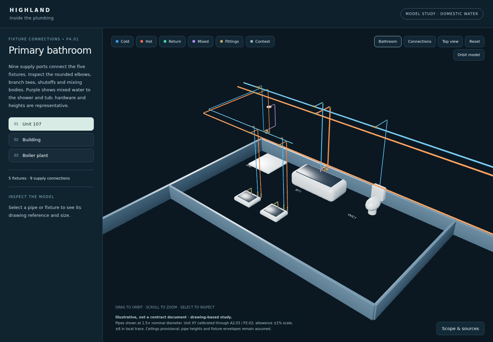

# Highland — actual pipe geometry, working model

A working model of the domestic-water pipes, fixtures and equipment, with Unit 107 shown in detail. Its plan scale comes from the architectural structural grid, floor datums follow A3.11, and Unit 107 ceiling heights are provisionally derived from the structural set and the unit RCP. Start with the review PDF; it includes a bathroom close-up and the calibration evidence.

**Illustrative, not a contract document.** A model study, not an as-built and not dimensionally verified.



[Fixture connection close-up](Unit-107-connections-preview.png) · [Full-unit view](Unit-107-preview.png)

## Downloads

Rebuilt 2026-11-04. Files over 1 MB are on the [`highland-water-2026-11-04` release](https://github.com/michaelcolenso/blender-models/releases/tag/highland-water-2026-11-04); checksums are in [`release-assets.json`](../../products/water/release-assets.json).

- [Animated plumbing view — 24-second MP4](https://github.com/michaelcolenso/blender-models/releases/download/highland-water-2026-11-04/Unit-107-plumbing-animation.mp4) — bathroom orbit, fixture connections, then full-unit context. A [10-second preview GIF](https://github.com/michaelcolenso/blender-models/releases/download/highland-water-2026-11-04/Unit-107-plumbing-preview.gif) covers the bathroom orbit.
- [Model review PDF](https://github.com/michaelcolenso/blender-models/releases/download/highland-water-2026-11-04/Highland-pipe-model-review.pdf) — ten pages; the last lists what is checked and what is still needed.
- [Bathroom pilot PDF — two pages](https://github.com/michaelcolenso/blender-models/releases/download/highland-water-2026-11-04/Unit-107-bathroom-pilot.pdf) — the five fixtures and their supply connections.
- [Interactive 3D model](https://github.com/michaelcolenso/blender-models/releases/download/highland-water-2026-11-04/Highland-plumbing-3D.html) — download, then open the HTML in a browser. All models and code are embedded.
- [Drawing-overlay review](https://github.com/michaelcolenso/blender-models/releases/download/highland-water-2026-11-04/Unit-107-trace-review.html) — download and open in a browser; toggle the modeled routes over P4.01.
- [Editable Blender model](https://github.com/michaelcolenso/blender-models/releases/download/highland-water-2026-11-04/Highland-domestic-water.blend) — building, plant and unit collections; opens on the Unit 107 bathroom.
- GLB models: [Unit 107](https://github.com/michaelcolenso/blender-models/releases/download/highland-water-2026-11-04/unit.glb), [building distribution](https://github.com/michaelcolenso/blender-models/releases/download/highland-water-2026-11-04/building.glb), [boiler plant](plant.glb).
- [Source sheets P2.02, P3.02, P4.01, A2.03 and A3.11](Source-reference-sheets.pdf) (unchanged from the October issue).
- [Validation results](validation.json), [video validation](video-validation.json), [calibration and ceiling derivation](calibration.json), [provenance contact sheet](provenance-review-contact.jpg).
- [Proposed repipe strategy — installation and unit-by-unit cutover](../repipe/)

The P1 corridor scene (`p1.glb`, `P1-trace-review.html`) is built by the product but not handed over here.

## Sources

- **RL–REVISED Highland Condos Plumbing**, October 29, 2007: P3.02 riser diagram and boiler piping, P4.01 Unit A / 107 plan (governing for Unit 107 routing).
- **200 W. Highland Construction Plans**, April 2, 2007: A2.03 and A3.11 (structural-grid dimensions, floor elevations), A2.02 (P1 architecture), A7.63 RCP Unit 107 (Addendum 1, May 1, 2007), and P2.2 (September 28, 2006, reference only / separate permit) for the P1 trace.
- **Structural Plans**, Perbix Bykonen, April 2, 2007: S3.7 and S3.8 sections give the R1 slab and band-beam soffit elevations over P1.

## What is documented, provisional and assumed

- **Documented:** building floor datums (A3.11: P1 342.00 ft, R1 353.00 ft); pipe sizes and connection patterns from P3.02/P4.01.
- **Provisional:** Unit 107 and P1 plan XY (structural-grid calibration, ±1% scale, ±6 in local trace). Unit 107 ceilings: band-beam soffit 351.21 ft less the A7.63 drops gives living/dining 102.5 in, hallway 98.5 in, laundry 92.5 in above the P1 floor. RFI 99, ASI 54, RFI 245, RFI 344, RFI 201 and RFI 366 revised these conditions; their responses will not be supplied, so these derived heights are the working basis and remain provisional.
- **Assumed:** overhead pipe heights CW 108 / HW 106 / HWC 104 in, held inside the 102.5–109.56 in ceiling-to-soffit band (a constraint, not a measurement; no drawing gives pipe elevations); building stack XY; fixture and equipment envelopes; fittings, stops and wall-side offsets.
- **Unresolved:** the dishwasher supply connection (omitted), the 04 stack R1 continuation, and the exact P1-to-P4.01 tie-in.
- Domestic water only; sanitary, vent and gas are not modeled.

In the viewer, **Bathroom** and **Connections** show the fixture stops and supply connectors, and **Fittings** toggles the representative hardware. The previous [sheet-stack tour](../owner-tour/) is superseded.

## Rebuild

```bash
uv run bm run highland/water build    # bpy: .blend, GLBs, review renders, validation.json
uv run bm run highland/water viewer   # viewer HTML, trace reviews, review and pilot PDFs
uv run bm run highland/water video    # MP4, preview GIF, viewer preview PNGs
```

Outputs land in `build/highland-water/`. Scope, assumptions and method: [product README](../../products/water/README.md).
