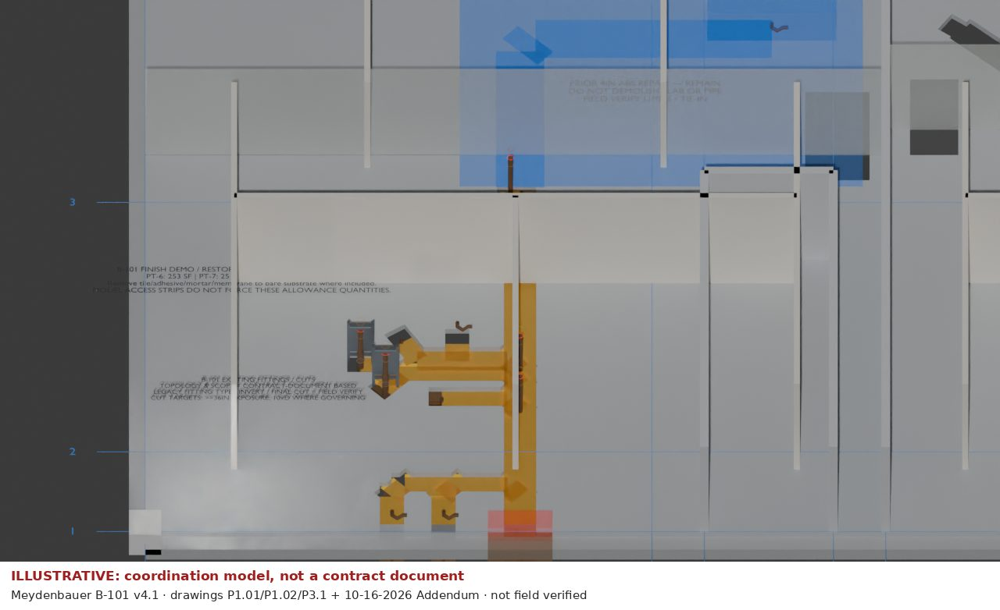
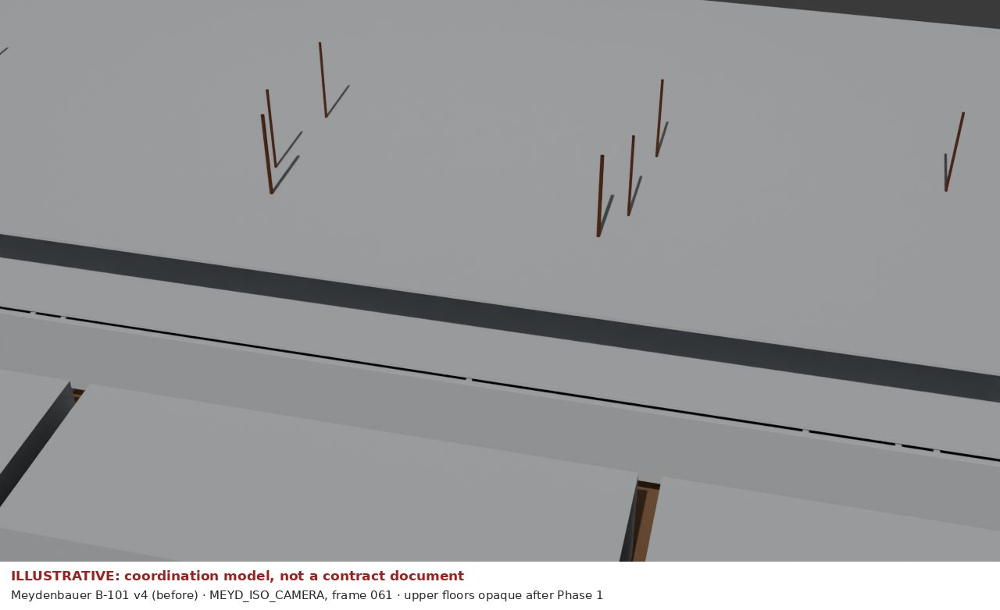

# Meydenbauer B-101 — demolition model review (v4 → v4.1)

An experimental run of the review workflow on the recovered B-101 demolition model. v4 executed cleanly
but failed acceptance on two items. v4.1 fixes both through a small patch, and the package's own checks pass on it.
**Result: v4.1 accepted for coordination review only; every route, invert and fitting stays FIELD_VERIFY.**

**Illustrative, not a contract document.** A coordination model traced from plans, not field verified.



| Before (v4, default camera, frame 061) | After (v4.1, review camera) |
|---|---|
|  | [050 finish strip-out](B101_v41_050.jpg) · [068 sawcut](B101_v41_068.jpg) · [083 CI exposed](B101_v41_083.jpg) · [089 CI removed](B101_v41_089.jpg) |

How it was built, and the patch itself: [products/b101-review](../../products/b101-review/README.md).

## Acceptance checklist

The checklist is the recovered package's `BLENDER_REVIEW_CHECKLIST.md`. The v4 column is the earlier
execution's recorded result (recovered `checklist_review.md`); v4.1 is this run, on Blender 5.0.1 with
CPU Cycles.

| Item | v4 | v4.1 | Evidence (v4.1) |
|---|---|---|---|
| A. Preflight, strict build, save, reopen | pass | **pass** | All three runs exit 0 with `--fail-on-warning` |
| A. Phase controller, drivers | pass | **pass** | No invalid drivers or `MEYD_DRIVER_ERROR` at 13 checkpoints |
| B. Slab Boolean evaluated | pass | **pass** | 0 mismatches on a 3-inch grid against the cutter union; slab manifold, 5.5 in |
| B. No cut inside prior-ABS no-demo envelope | **fail** (38 samples, ~2.4 sf) | **pass** (0 of 6,400) | Cutters 001/008 clipped at y = 27.5 ft. The envelope edge is an **assumed** cut limit |
| B. Bend continuity, structural crossing | pass | not re-inspected | Same geometry except the clipped ends; DO_NOT_CUT_STRUCTURE tag retained |
| C. Route, 4→6 in continuity, +18 in lateral | pass | **pass (model only)** | Saved route controls match 6/6, 2/2, 4/4 points. Not re-checked against drawings; QA boards not recovered |
| C. Prior ABS distinct and protected | partial | **pass** | Main trench now stops at the envelope (frames 068–089) |
| D. Demolition sequence 001–089 | pass in cutaways | **pass** | All eight keyframes viewed from the review camera. 038 shows access items starting to move, not yet stored. 089 keeps excavation overlays |
| E. Fittings, traps, carriers, cuts, supports | pass | **pass** | 10 junctions, 7 traps, 7 bends, 2 carriers, 10 supports |
| F. Camera shows B-101 clearly; X-ray does not obscure | **fail** | **pass** | `MEYD_B101_REVIEW_CAMERA` plus a render-only cutaway of upper floors, east/north walls and soil |
| F. No black or blank frames | see inventory | **pass** | Eight frames viewed |
| **G. Outcome** | **REVISION REQUIRED** | **ACCEPTED FOR COORDINATION (experimental)** | Not for fabrication or as-built |

## What still needs a person

- **Envelope boundary:** the prior-repair no-demo envelope is a broad box drawn from the P1.01 cloud. Where
  the trench may actually stop near the prior-ABS tie is a field call.
- **Readability:** in-scene annotation text overlaps and is hard to read in the review view. Fix it before
  any render goes to a scope, PCO or resident notice.

## Rebuild

```bash
uv run bm run meydenbauer-b/b101-review build   # writes build/meydenbauer-b/b101-review/ and these JPEGs
```

The `.blend` is not handed over (about 14 MB). `build` regenerates it at
`build/meydenbauer-b/b101-review/pkg/output/`.
