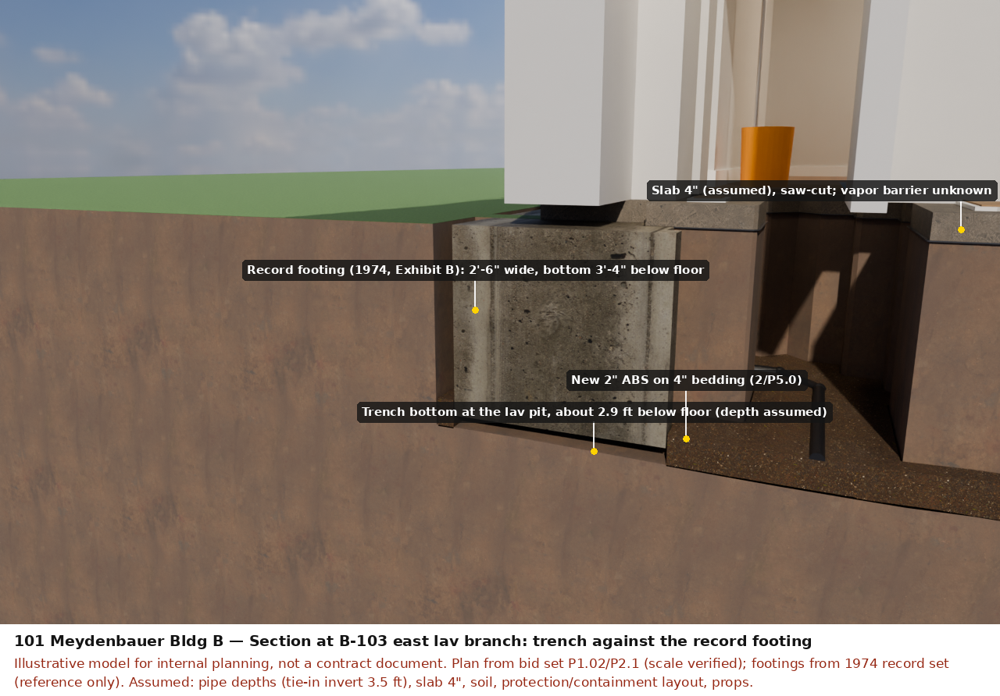
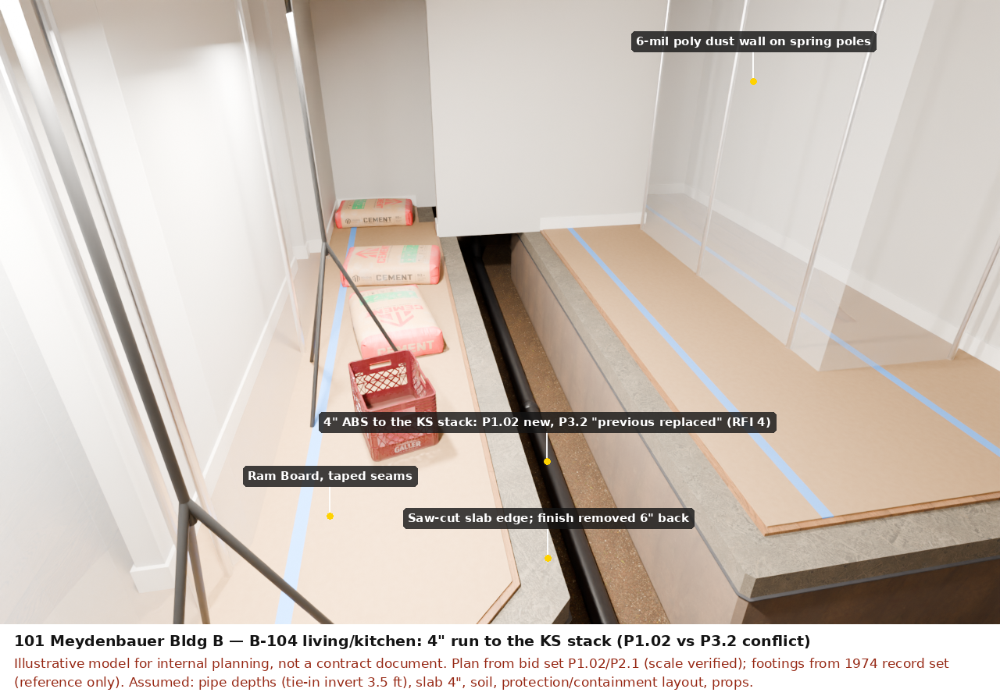

# Building B: construction-phase views (bid team only)

What the work looks like inside the occupied units. Rendered from
[projects/meydenbauer-b/products/underslab/realism.py](../../../products/underslab/realism.py); sources and
assumptions are in [REALISM.md](../../../products/underslab/REALISM.md). Every image
carries its assumption band. These images show KEAD's drawings and are not for distribution.

| View | What to look at |
| --- | --- |
| [Section at B-103 east lav branch](section_b103_east-preview.png) | The 1974 strip footing (2'-6" wide, bottom 3'-4" below the floor) beside the lav-pit trench; bedding, pipe, slab, vapor barrier |
| [B-104 kitchen run](b104_kitchen_run-preview.png) | 4" run to the KS stack: saw-cut edges, open trench, Ram Board, poly dust walls (the run in RFI 4) |
| [B-104 master bath](b104_master_bath-preview.png) | Lav branches dug at the east wall; shower; the slab peninsula left between the two lav trenches |
| [B-104 plan cutaway](b104_plan-preview.png) | All B-104 trenches, protection zones and staging; north up, east right |
| [B-104 overview](b104_overview-preview.png) | The unit during the work, with ceilings and dust walls hidden |

[Editable model (.blend, textures packed, Git LFS)](Meydenbauer-B-construction.blend). Its
collections:

- ground and structure;
- new piping and bedding;
- building;
- ceilings;
- temporary protection;
- props.

These previews were rendered on 4 CPU cores at 1280×800 and 64 samples. For 2560×1600 at 512
samples, or 3840×2400 at 1024 samples, run
[runpod_render.sh](../../../products/underslab/runpod_render.sh) on one RTX 4090.

## Not modelled, or assumed

- **Pipe depth and trench depth.** Both assume a 3.5 ft tie-in invert.
- **Slab, vapor barrier and soil.** The slab is assumed to be 4". Groundwater is not shown,
  although the SOR reports a high water table.
- **Protection and containment layout.** Assumed, as are the window sill and head heights and
  the props.
- **Kitchen cabinetry and vanities.** Not modelled. Vanities are shown as pulled, and toilets
  stand on the protection.
- **Upper floors.** Not modelled.
