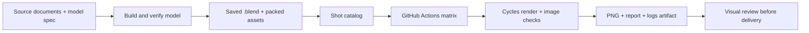

# Render saved models with GitHub Actions

Commit an editable model, list its scene/camera/frame in `render/scenes.json`, and
let [Render saved Blender scenes](../.github/workflows/render-scenes.yaml) produce
reviewable PNGs and reports. This extends the repository's existing spec-to-model
pipeline; model builders remain responsible for geometry and provenance checks.



## Inputs and repository layout

| File | Responsibility |
| --- | --- |
| `render/scenes.json` | Stable shot IDs, model paths, exact scene/camera names, frame and assumption notice |
| `pyproject.toml` / `uv.lock` | Pinned Blender Python runtime and Pillow (repo-wide lock) |
| `src/bmodels/render_plan.py` | Validate the catalog and create one matrix job per shot |
| `src/bmodels/render_scene.py` | Open a model, select its shot, render, validate pixels and write evidence |
| `.github/workflows/render-scenes.yaml` | Triggers, isolated runners, dependency cache and artifact retention |
| `tests/test_render_workflow.py` | Invalid-input and image-validation checks |

The starter shot uses the existing Highland domestic-water model, `Scene`,
`Camera`, frame 1. Its provisional and assumed dimensions are stated in the
catalog and appended to the output image. It is an illustrative coordination
model; rendering does not establish dimensional accuracy.

For a GLB, FBX or OBJ input, first import it into an authored `.blend` scene with
the intended units, materials, lights and camera. Save that scene through the
project's model-building process. Keep existing and proposed conditions separate.
This avoids choosing scale or lighting implicitly during CI.

To add a shot, copy a catalog entry and change its ID, model, scene, camera,
frame and notice. Paths are relative to the repository root. IDs must be unique,
lowercase and safe for artifact filenames; `all` is reserved. Each frame must be
inside its scene's saved timeline. The workflow supports up to 128 shots, with
two running at a time.

Pack textures and fonts into the `.blend` where possible. Otherwise commit the
referenced files and use relative paths. Rendering fails on missing dependencies.
The dependency check follows the selected scene's referenced data. Saved UI brush
catalogs, asset-browser paths and unrelated unused data do not block rendering.
This starter handles ordinary external file paths; pack or adapt resolution for
UDIM patterns, image sequences and simulation caches before adding those scenes.
Embedded Python auto-execution is disabled. Bake scripted drivers and add-on
effects into the scene, or use a reviewed project-specific renderer for them.
Git LFS files are restored by the render job; LFS bandwidth and storage apply.
For large repositories, narrow LFS downloads to each shot's dependencies.

## Triggers and quality

| Trigger | Selection | Quality |
| --- | --- | --- |
| Pull request affecting model/render inputs | Every cataloged shot | Preview: 640 px longest edge, 16 samples |
| Push to `main` affecting model/render inputs | Every cataloged shot | Final: 1600 px longest edge, 128 samples |
| Actions → Render saved Blender scenes → Run workflow | One shot ID or `all` | Preview or final; preview is the default |

Both profiles use Cycles CPU, denoising and seed 0. The original image aspect
ratio and camera framing are preserved. A white assumption footer is added below
the render, so the delivered PNG is taller than the rendered scene. Geometry,
materials, camera animation and existing scene overlays come from the saved file.
The renderer does not overwrite the source `.blend`.

Changing a source spec alone does not update a saved model. Run its builder and
geometry checks, then commit the resulting model before using this workflow. If
combining both stages into one workflow later, have a build job upload the exact
verified `.blend` and dependencies, and make render jobs download that artifact
with `needs: build`; do not fetch an unspecified "latest" model.

## Run locally

Use Python 3.11, the system libraries listed in the workflow, and a virtual
environment. From the repository root:

```bash
uv sync
uv run bm render-plan
uv run python -m unittest discover -s tests -p test_render_workflow.py
uv run bm render \
  --shot highland-water-overview --profile preview --device CPU \
  --output build/scene-renders/highland-water-overview
```

The local command uses the same Blender Python API as CI. A desktop Blender
installation is not required. The renderer checks that its Blender version is
5.0.1; change the dependency pin and version check together when upgrading.

## Outputs and acceptance

Each job uploads `render-<shot>-<profile>-<attempt>` for 14 days, containing:

- `render.png`: rendered image with its model-assumption notice.
- `report.json`: commit/run IDs, model/dependency/output SHA-256 hashes, Blender
  version, settings, duration, pixel checks and failure details.
- `report.md`: concise job-summary report.
- `render.log`: Blender output captured by Actions, including failed renders.

The workflow fails on invalid configuration, missing model/scene/camera/assets,
out-of-range frames, render exceptions, incorrect dimensions, fully transparent
images or near-uniform images. Pixel checks run **before** the footer is added,
so the footer cannot make a blank render pass. Failed jobs still upload reports
and logs when available. A process killed by the timeout may have only a log.

These checks detect basic rendering failures. They do not establish correct
geometry, readable labels, a good camera composition or accurate source data.
Every automated report leaves visual review pending. Inspect the full image and
source model checks before delivery. Persist approved deliverables separately
before Actions artifacts expire; use the repository's release/delivery process.

The runtime and top-level packages are pinned, but this is not a fully hashed
dependency lock or a promise of identical pixels across hardware. For archival
production, also lock transitive dependencies or use a tested container digest,
record drivers/device hardware, and retain the validated inputs with outputs.

## Cost, caching and GPU rendering

The default uses standard GitHub-hosted CPU runners. It requires no render-service
account or application secrets. The uv cache avoids repeated package downloads;
it does not cache rendered images. The complete catalog is rendered on input
changes, avoiding missed texture or shared-asset dependencies. PR updates cancel
older preview runs. Main/manual runs have a 45-minute limit per shot and a
two-job concurrency cap. Actual minutes depend on scene complexity and account
limits; benchmark a preview before increasing quality.

For heavier scenes, use a separate trusted final-render workflow on a configured
GPU runner or have Actions submit a render-farm job and collect its outputs.
For an NVIDIA runner:

1. Use a dedicated runner label, for example
   `runs-on: [self-hosted, linux, x64, blender-gpu]`.
2. Install compatible NVIDIA drivers and the pinned runtime on an ephemeral
   runner image; adapt the Ubuntu `apt` step to that image.
3. Change the renderer argument to `--device OPTIX` or `--device CUDA`. The
   script requires a matching device and fails if none is available.
4. Run this workflow only from protected, trusted revisions or manual runs on
   those revisions. Keep PR previews on GitHub-hosted runners: a `.blend` parser,
   add-ons and repository Python code are all executable job inputs.

For animation, extend planning to non-overlapping frame chunks, render a PNG/EXR
sequence per chunk, and assemble with FFmpeg in a dependent job after verifying
the exact expected frame set. Retain frame artifacts so failed chunks can be
retried independently. The existing Highland film workflow demonstrates this
pattern; this starter deliberately renders still shots.

## Validation of this starter

Local validation used Python 3.11 and Blender 5.0.1, the same renderer pin as CI.
The catalog/image failure checks passed, the workflow passed `actionlint`, and
the configured Highland camera rendered successfully. The image was inspected
for visible model content and a readable assumption notice. This does not
revalidate the model's dimensional assumptions. GitHub-hosted execution still
needs its first run after these files are committed and pushed.
